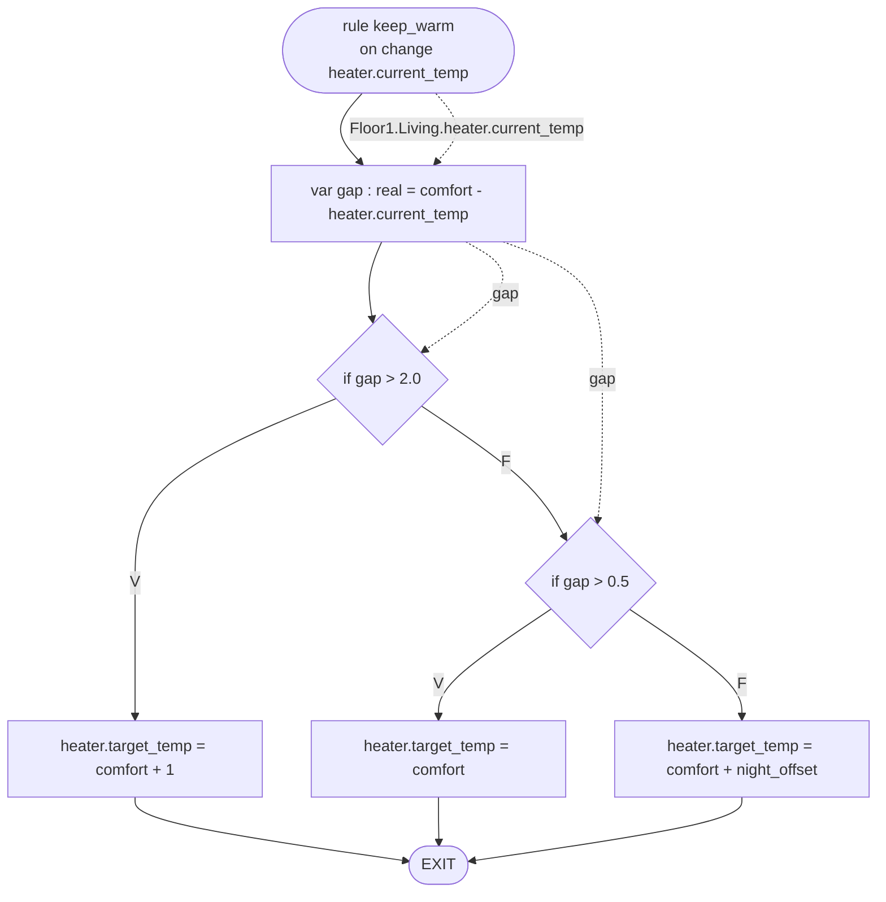
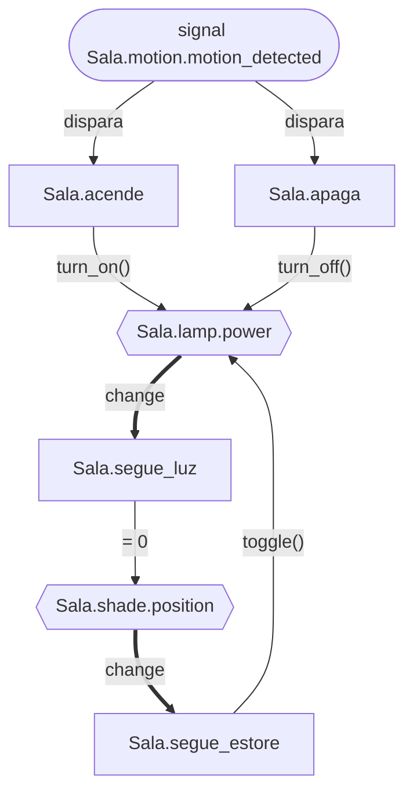

# Representações intermédias

A Parte II trabalha sobre três representações intermédias, construídas a partir do AST elaborado (`domo/ast.py`), em que cada referência já aponta para o símbolo que designa. Cada representação responde a um tipo de pergunta diferente:

| Representação | Pergunta | Módulo |
|---|---|---|
| Grafo de fluxo de controlo (CFG) | Que instruções se podem executar a seguir a esta? | [domo/cfg.py](../domo/cfg.py) |
| Cadeias definição-uso | Que escritas podem ter dado o valor que esta instrução lê? | [domo/dataflow.py](../domo/dataflow.py) |
| Grafo de interação de regras | Que regras podem disparar outras? | [domo/interaction.py](../domo/interaction.py) |

```
python -m domo.cfg examples/valid/03_full.domo [--unidade keep_warm] [--blocos] [--defuse] [--formato texto|dot|mermaid|svg] [-o f]
python -m domo.interaction examples/valid/03_full.domo [--formato texto|dot|mermaid|svg] [-o f]
```

## 1. Localizações: o estado do programa

As três representações falam de leituras e escritas de **localizações**, definidas em [domo/locations.py](../domo/locations.py). Há dois tipos:
- variáveis, globais ou locais;
- propriedades de dispositivos (`Floor1.Living.lamp.brightness`), que são o estado da casa.

As constantes ficam de fora, porque nunca mudam.

Três decisões dependem do domínio:

- **Comandos escrevem propriedades.** `lamp.turn_on()` altera `lamp.power`. O catálogo de dispositivos passou a ter uma entrada `effects` com estas relações. Sem ela, o grafo de interação não veria que acender uma luz pode disparar uma regra `on change lamp.power`.
- **Escritas através de um `for` são fracas.** Dentro de `for l in night_lights`, cada execução de `l.turn_off()` escreve **um** dos candeeiros do grupo. Uma escrita fraca acrescenta uma definição sem apagar as anteriores; uma escrita num dispositivo concreto é forte e substitui-as.
- **O nome de dispositivo de um `for` não é um valor.** A variável `l` designa um dispositivo e nunca é lida como valor, por isso não entra nas cadeias definição-uso.

## 2. Grafo de fluxo de controlo

Há um CFG por regra e por cena. Cada instrução é um nó. `if`, guardas `when` e testes de ciclo são nós de decisão, com uma saída V e uma F.

| Construção | Forma no CFG |
|---|---|
| `s1; s2` | `s1 → s2` |
| `rule R on E when c { A }` | `ENTRY → [when c]`, que segue para `A` (V) ou para `EXIT` (F) |
| `if c { A } else { B }` | `[if c]` segue para `A` (V) ou `B` (F); os dois continuam na instrução seguinte. `else if` é um `if` no ramo F |
| `repeat n times { A }` | `[repeat n] → [mais uma iteração?]`, que segue para `A` (V) ou para a instrução seguinte (F); `A` volta ao teste |
| `for x in g { A }` | igual ao `repeat`, com o teste `x ← próximo de g` |
| `activate S` | nó de chamada, que continua na instrução seguinte |

O ENTRY de uma regra mostra o evento que a dispara (`on change heater.current_temp`). O CFG representa o que acontece **depois** de o evento ocorrer.

**Terminação.** O Domo não tem `while`. O teste de um `repeat` ou `for` dá F ao fim de um número finito de voltas, por isso todos os caminhos chegam ao EXIT. Os testes verificam esta propriedade em todos os programas.

**Blocos básicos** (`--blocos`). Os nós podem ser agrupados em sequências máximas em que só se entra pelo primeiro nó e só se sai pelo último. Isto dá uma vista mais compacta, útil para o relatório e para programas grandes.

**CFG interprocedimental.** `activate S` liga o nó de chamada ao ENTRY do CFG de `S` (seta tracejada, sem `--unidade`). A ligação não distingue de onde a cena foi chamada. Basta para as análises previstas, porque o Domo não tem parâmetros nem valores de retorno: uma cena só lê e escreve o estado global.

Exemplo: a regra `keep_warm` de `03_full.domo`, com as cadeias definição-uso a tracejado (`--defuse`):



## 3. Cadeias definição-uso

Uma cadeia liga uma escrita a uma leitura que pode receber esse valor. Para as calcular é preciso saber que escritas chegam a cada nó, o problema das **definições que chegam** (*reaching definitions*). É resolvido com o framework genérico de fluxo de dados de [domo/dataflow.py](../domo/dataflow.py), que as análises da Fase 2 reutilizam.

| Componente | Definição |
|---|---|
| Facto | Conjunto de pares (nó que escreve, localização) |
| Direção | Para a frente |
| Início (ENTRY) | Uma definição de cada localização usada, que representa o valor vindo de fora da regra: inicialização, outras regras, sensores |
| Junção | União, porque basta haver um caminho |
| Transferência | `OUT = (IN − definições apagadas) ∪ escritas do nó`; só uma escrita forte apaga as definições anteriores da mesma localização |

O resultado calcula-se iterando até nada mudar (ponto fixo). A iteração termina porque os conjuntos só crescem e o número de definições é finito.

No exemplo acima, `gap` é escrito no nó 2 e lido nos dois `if`. A leitura do sensor vem do ENTRY, porque o seu valor vem de fora da regra.

## 4. Grafo de interação de regras

É a representação específica do domínio. Numa linguagem Evento-Condição-Ação, o comportamento importante está **entre** regras: uma regra muda uma propriedade, e essa mudança dispara outra regra. O CFG não mostra isto, porque cada CFG só descreve uma regra.

| Nó | Exemplo |
|---|---|
| Evento | `signal motion.motion_detected`, `at 23:00`, `every 5 min` |
| Regra, cena | `Floor1.Living.welcome`, `goodnight` |
| Propriedade (escrita ou observada) | `Floor1.Living.lamp.power` |

| Aresta | Significado |
|---|---|
| evento → regra | a regra reage ao evento |
| propriedade → regra (`change`) | a regra reage a mudanças da propriedade |
| regra/cena → propriedade | a regra escreve a propriedade (atribuição ou efeito de um comando) |
| regra/cena → cena (`activate`) | ativação de uma cena |

As escritas vêm dos nós do CFG, por isso incluem as que estão dentro de `if` e de ciclos. O grafo mostra o que **pode** acontecer. As escritas de uma regra incluem as das cenas que ela ativa, direta ou indiretamente: `bedtime` escreve `Floor1.Hall.door.locked`, através de `goodnight`.

Um caminho `regra A → propriedade P → regra B` significa que A pode disparar B. Este grafo expõe os dois problemas que a análise da Fase 2 vai detetar:



- **Conflito.** `acende` e `apaga` reagem ao mesmo evento e escrevem `lamp.power` com valores opostos. O estado final depende da ordem em que as regras correm.
- **Cascata cíclica.** `lamp.power → segue_luz → shade.position → segue_estore → lamp.power`: as regras podem disparar-se umas às outras sem fim.

Em `03_full.domo` não há cascatas, mas `welcome` e `night_dim` reagem ao mesmo evento e escrevem ambas `lamp.brightness` (30 e 10). A `priority 1` de `night_dim` desempata, e a análise de conflitos terá de ter isso em conta.

## 5. Verificação

Em [testes/test_ir.py](../testes/test_ir.py) (`python -m testes ir`):

- **Invariantes em todos os CFG dos 33 programas válidos dos testes:**
  - o ENTRY não tem predecessores e o EXIT não tem sucessores;
  - todos os nós são alcançáveis a partir do ENTRY e todos chegam ao EXIT;
  - as decisões têm exatamente as saídas V e F, e os outros nós uma única saída;
  - os blocos básicos particionam os nós.
- **Forma exata do CFG** de regras vazias, guardas, `if` sem `else`, `repeat` vazio, `keep_warm` e `bedtime`.
- **Cadeias definição-uso:** escrita forte que apaga, escrita dentro de `if` que não apaga, escrita através de `for` que é fraca.
- **Grafo de interação:** a cascata acima e as escritas propagadas por `activate` encadeados.
- **Exportação:** 138 grafos DOT aceites pelo Graphviz, mais os Mermaid correspondentes.

Para garantir que os testes não passam por acaso, introduziram-se dois erros de propósito: todas as escritas passaram a fracas, e a saída F das guardas foi removida. Ambos foram detetados.

## 6. Limitações

- O CFG interprocedimental não distingue os pontos de chamada de uma cena. Não faz diferença sem parâmetros, mas uma análise sensível ao contexto teria de os separar.
- O grafo de interação é uma sobreaproximação. Uma escrita dentro de um `if` que nunca é verdadeiro continua a aparecer. A propagação de constantes da Fase 2 reduz este problema.
- As mudanças vindas do ambiente (sensores, ações manuais) não estão modeladas. Uma regra `on change probe.value` só é disparada pelo exterior.
- Os efeitos de `wait` no tempo não estão representados. Duas regras que escrevem a mesma propriedade em momentos diferentes da sua execução aparecem como escritas da mesma regra.
